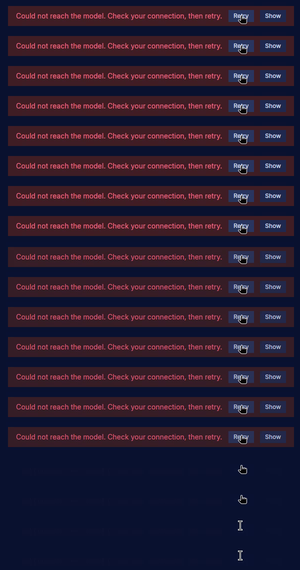
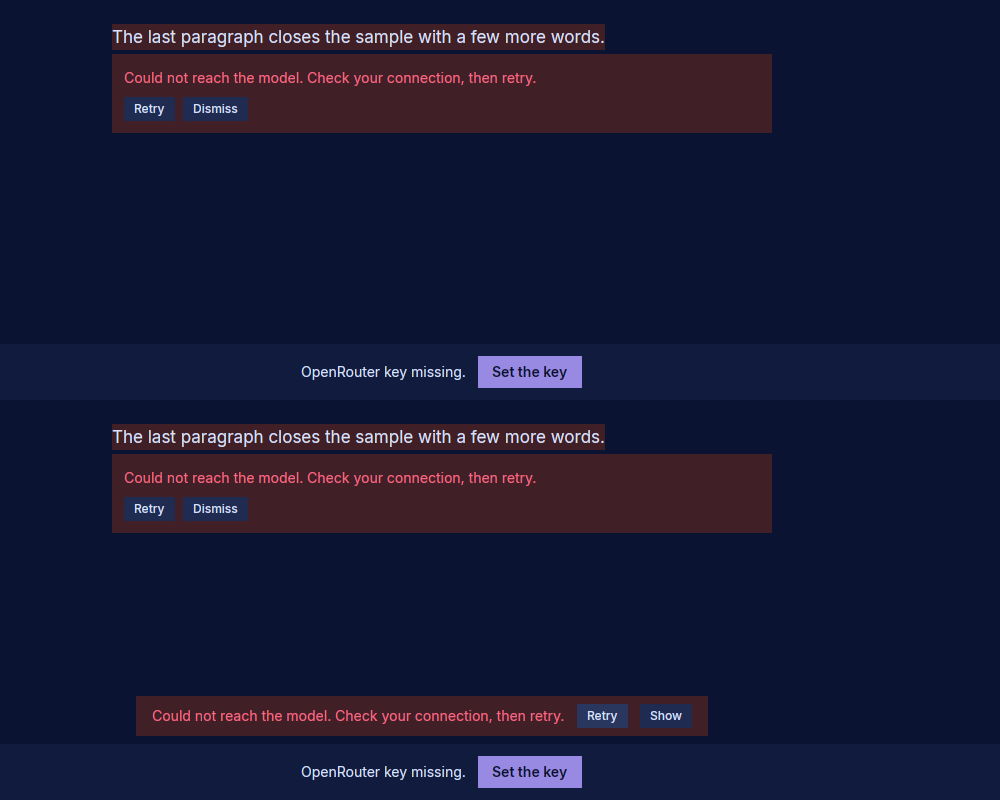
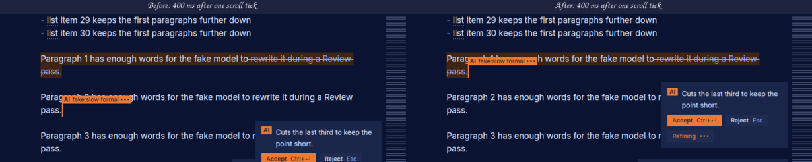

# The cached editor pane, flow by flow

The workspace caches the editor pane (`.cached(..)` in `Workspace::render_editing`), so the AI caret's island can draw its frames without the pane. A cached view is drawn again only when it, or an entity it read while rendering, is notified, when its bounds change, or when the window refreshes (`gpui-pre 0.3.12`, `src/view.rs`). This note records the check of every flow in the README's "What it does" with that cache on (ginga issue #10).

## Result

No flow showed a stale pane, and this check added no notify. The cache needed one, which came with the caret work itself: when the open file becomes or stops being a Skill, `Workspace::refresh_frontmatter` notifies the pane (its Quick actions differ). It notifies only on that change. One place changes the pane without notifying it, and it stays, for the reason given under "Static check".

## How it was checked

- The app ran under Xvfb (1440 × 900) with `DESAFINADO_FAKE_AI=1` and a fresh `DESAFINADO_USER_DATA_DIR`, driven by XTest input.
- A build used only for this check added one switch that drew the pane uncached. Each flow ran twice with the same input and timing, once cached and once uncached. The screenshots were compared pixel by pixel (8 % fuzz). A stale pane shows as a difference: the uncached pane is redrawn whenever the workspace is, the cached one is not.
- The caret did not blink in these runs (`caret.json` with `"blink": "off"`). While the editor has focus, the default blink notifies the editor every second, and the cached pane is drawn again with it, so a stale frame would last at most a second and be missed. A first run of the first seven flows with the blink on agreed with these.
- The switch is not in the app.

The full run took 46 screenshots, and 43 are identical. The 3 that differ do so only in time, not in state: the clock time of a Version (`13:08` against `13:10`) in its header and in the "Restored" toast, and where the AI caret's three dots were in their pulse. Four flows were run again after the first pass did not do what they meant to (Library, Preferences, spelling, Revise); 17 of those 18 screenshots are identical; the other, discussed under "Spelling marks after typing", came out differently from run to run in both modes.

## Flows

| Flow | What it shows, cached | Cached = uncached |
| --- | --- | --- |
| Typing | Each typed character at once | yes |
| Ask (`Ctrl+K`) | Bubble, its rows filtered by "shorter", the request in the tray, then the answer in place with the struck-through Original and the Card; the tray entry gone | yes |
| Accept, undo | `Ctrl+Enter` writes the Replacement and drops the Card; `Ctrl+Z` brings the Original back, selected, with the bubble over it | yes |
| Reject | `Esc` drops the Suggestion and the Card | yes |
| Refine | The Refine field, then the AI caret with "more formal" while it runs, the new version, `Ctrl+H` / `Ctrl+L` stepping `‹ 1 / 2 ›` | yes (the AI caret's place inside its glide differs by timing) |
| Review, Comment mode | AI caret "Reviewing", then numbered marks and the Editor's notes panel; a mark opens its Note; a Note picked in the panel (a workspace view) opens on its mark in the pane; Dismiss; Suggest rewrite gives a Suggestion ([screenshot](cached-pane-flows/review-notes-cached.png)) | yes |
| Review, Revise mode | From the Comment Review, the mode chip runs it again as a Revise: "Review: 1 suggestion", a block Replacement with its Card. From Edit → Review… with the focus "fix the spelling" or "rewrite for clarity", the header chip says Revise and the fake model returns "Review: no suggestions" | yes (dots' pulse) |
| Spelling menu | A click on "mispeled" opens the menu; a click on "misled" fixes it and the mark goes. `F8` opens the menu with the keys in it (`Enter` on the first fix), and `Enter` takes it. After a click the menu does not take the keys: `Enter` breaks the line in the text, in both modes | yes |
| Reading view | `Ctrl+Alt+R` shows the rendered text and swaps back | yes |
| Restore a Version | Save, then the first dot opens the compare view with the marks of what Restore changes; Restore puts that text back in the pane | yes (clock time) |
| Library | `Ctrl+B` opens it; the Skill's folder opens in the tree; its `SKILL.md` opens in the editor with the Frontmatter panel and "Opened SKILL.md" | yes |
| Preferences | A theme (Solitude) recolors the pane at once; caret Block and spelling Off; a Quick action turned on ("More formal") is in the next bubble's list (`↓`) | yes |

Not covered: the real model and network, a window wide enough for margin Cards (these runs had floating Cards), Wayland, the Evals page and AI spend (they replace the pane rather than draw over it), and a file changed on disk.

## Spelling marks after typing

With the caret steady, a word typed wrong ("Teh wrongg") got no mark within 4 s, in the cached run, in the uncached one, and in a build of `d3ac281` without the caret work. A timed log of `check_spelling` and `show_progress` shows why: the check that should run 400 ms after the last key did not publish while the app sat idle. It published only after the next input (a click, `F8`). Whether marks are drawn right after that next input then depends on which check finishes first, which is why one screenshot differed between runs in both modes. This is older than the caret work and not about the cache. With the default blink, the blink keeps the app waking, which may be why it does not show in daily use. It was not followed further.

## Static check

Every place outside the pane that changes it (`crates/app/src/workspace.rs`, 22 calls into `EditorPane`) notifies it, directly or through a method that does, or edits the editor's `InputState`, which the pane reads, so GPUI draws the pane again. Each global the pane reads (`Roles`, `CaretChoice`, `SpellChoice`, `WordbookChoice`, reduced motion) is written only at start or followed by `refresh_windows`, and a refresh draws every cached view again. The shared cells inside the pane (`bounds`, `heights`, `pointer_down`) notify the pane when they change.

The one change without a notify, which stays: `Workspace::render` calls `EditorPane::forget_bubble` when the text is not shown (Reading view, History, AI spend, Evals). The pane is then not in the tree, so GPUI keeps no cached frame of it, and it is rendered in full when it comes back.

A check that the comparison catches a missing notify was tried: the `cx.notify()` in `EditorPane::set_notes` was removed for one run. The Review's marks still showed at once, because `set_notes` also calls `refresh_decorations`, which updates the editor entity the pane reads. Most of the pane's changes reach the screen that way, which is part of why nothing turned up stale.

Seen once and not again: in the first cached typing run, " Typed wrongg" was in the text twice. It was still there 1.5 s later, after the blink had drawn the pane again, so it was in the text and not a stale frame. Two more runs in each mode typed it once. It is most likely a doubled key event from the test driver.

## The AI caret's paint order

It stays above everything the pane draws over its text, where they overlap: the text map and its chips, the Notes' marks, an open Note, the requests tray, the Suggestion Cards, the bubble and the spelling menu. On `main` the caret came before all of them in the pane. The caret breathes and glides for as long as a Refine or a Review runs, and each of its frames is a frame request from its view. GPUI notifies the view that asks and marks every view above it dirty (`Window::request_animation_frame`, `Window::mark_view_dirty`). Drawn inside the pane, under its Cards, the caret would draw the whole pane again on every one of those frames, which is what caching the pane avoids. Putting it below them and keeping the cache would mean moving them out of the pane into a view of their own, with their actions, for an overlap that is rare: the flag sits above the caret's line, and a floating Card under the range. The reason is in `crates/app/src/ai_caret_view.rs` and the difference in `docs/PARITY.md`.

## A toast's buttons while it leaves

A click on a toast's button while the toast leaves does nothing. Shown by a recording:

1. The fake model fails ("fake:network" as the instruction), so a toast with Retry and Show comes up for 12 s.
2. The pointer rests on Retry. A script reads the button's color every ~30 ms; when the exit fade starts, it clicks Retry three times, 4, 92 and 180 ms later, while the screen is recorded at 60 fps.
3. Control: the same toast, with Retry clicked while it is still up.

| | Clicks on Retry | AI calls in `ai-calls.jsonl` | 1.5 s later |
| --- | --- | --- | --- |
| While leaving | 3 | 1 (the first failure only) | no toast |
| While up (control) | 1 | 2 (the retry ran) | a new failure toast |

The exit is short on screen: with `Easing::OutQuart` over 180 ms, the toast is nearly transparent within one frame and gone after about four. The first click landed in those faint frames, while the button was still under the pointer; the other two came at the end of the exit or just after it. None ran the action.

The recording was made with only the `is_wanted` check at the top of `Workspace::run_toast_action`. Since then a leaving toast's buttons also take no pointer at all (no click, hover or hand cursor; `ui::takes_input`), and the check stays as a second guard.

## Scrolling with the editor unfocused

Found in review. With the editor unfocused (a Refine field holding the keys, say), one scroll tick moved the text but left the Cards and the AI caret a step behind, until something else redrew (here the requests tray's clock, up to a second later). Both place themselves from the editor's last layout while a frame is drawn, and the input only asked for another frame when the caret on screen moved. The Cards are inside the pane and read the layout the same way on `main`, so this does not come from the island or the cache (not run on `main` to confirm). The patched `gpui-base` now asks for the next frame when the visible lines move (`vendor/gpui-base/PATCH.md`). Under Xvfb, with reduced motion on and a slow Refine running:

